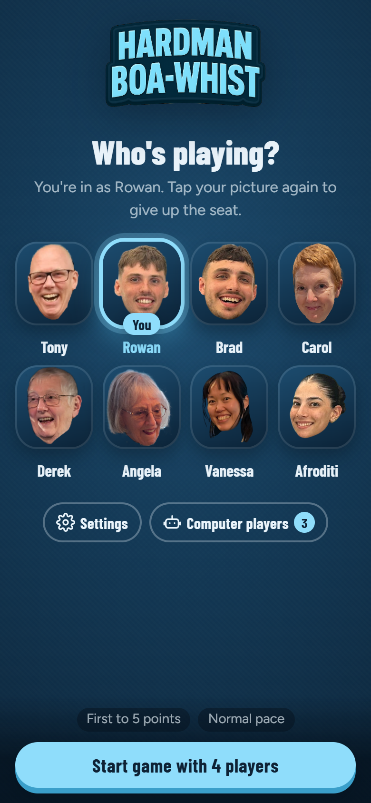
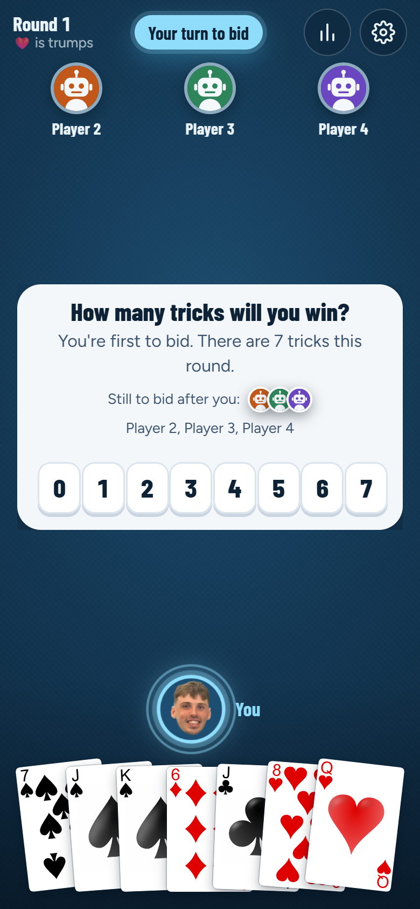
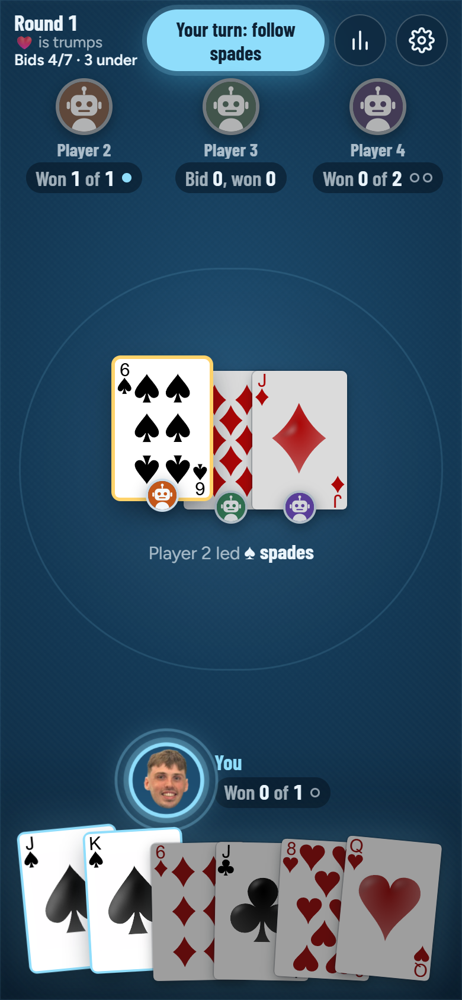
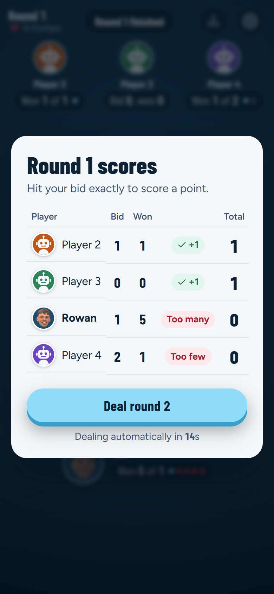

<p align="center">
  
</p>

<p align="center">
  <strong>The Hardman family's favourite card game, now on your phone.</strong><br />
  <a href="https://hardman-boa-whist.pages.dev/">▶ Play it at hardman-boa-whist.pages.dev</a>
</p>

---

Boa-Whist is a trick-taking card game for 2–7 players. Everyone is dealt 7 cards, guesses how many tricks they'll win, and then tries to win **exactly** that many: no more, no fewer. Hearts are always trumps. Hit your bid and you score a point. First to the target score wins.

Each player uses their own phone. Open the link, pick your face, and the server deals the cards, checks every move and keeps score.

<p align="center">
  
  
  
  
</p>

## How to play

### 1. Join the table

1. Everyone opens **https://hardman-boa-whist.pages.dev/** on their own phone or computer. If nobody has played for a while, the game server takes up to a minute to wake up; you'll see the logo with the family's faces circling it until it's ready.
2. Tap the logo to get past the intro.
3. Tap your picture on the **Who's playing?** screen. You'll see a **You** badge on your own seat and an **In** badge on everyone else who has joined. Tap your picture again to give up the seat.
4. When at least two people are seated, anyone with a seat can press **Start game with N players**. There's a 3-second countdown, and anyone can cancel it. It's also cancelled automatically if someone joins, leaves or drops their connection.

**Visitors** who aren't in the family pictures tap **Visiting? Join as a guest** and type their name (up to 16 letters, and not a family member's or a computer player's name). They get a picture made from their initials and play like anyone else. Tap ✕ on your name to give up a guest seat.

> Everyone joins the same table, so there's no room code to share. If you arrive while a game is under way, you **watch it live** (everyone's cards stay hidden) and join the table automatically when it finishes.

### 2. Bid

Each round, every player is dealt **7 cards**. Starting with the first player and going round the table, each player picks a bid from **0 to 7**: the number of tricks they think they'll win.

**The last bidder can't make the bids add up to 7.** There are exactly 7 tricks in a round, so this means at least one person is guaranteed to miss. The app greys out the forbidden number for the last bidder.

### 3. Play the tricks

- The first player leads any card. Everyone then plays one card in turn.
- **You must follow suit** if you can (play a card of the same suit that was led). If you can't, you may play anything, including a trump.
- **Hearts ♥ are always trumps.** The highest heart wins the trick. If no hearts were played, the highest card of the suit that was led wins.
- Aces are high (2 is lowest, A is highest).
- Whoever wins a trick leads the next one.

Under each player you'll see a tracker like **Won 1 of 2**: tricks won so far out of what they bid. Tap it to see the tricks they've won this round, card by card.

Players who have already played to the current trick (or already bid) are dimmed, so you can see who's still to go.

The top of the screen shows the **bid balance**, e.g. **Bids 9/7 · 2 over**: the total bid against the 7 tricks. Over means not everyone can make their bid; under means there are tricks to spare. The same appears on the table between tricks and in the 📊 scores.

**Reactions:** tap your own picture to send a quick reaction ("What a play", "Slider", "Ouch", "Haha", "Got 'em", "Incoming"). Everyone at the table sees it as a speech bubble.

### 4. Score

After all 7 tricks, the round summary shows each player's bid and how many tricks they won:

| Result | Points |
| --- | --- |
| Won **exactly** the number of tricks you bid | **+1** |
| Won more or fewer than your bid | 0 |

The next round deals automatically after a short pause (or press **Deal round N** to skip ahead). The first bidder moves one seat clockwise every round.

### 5. Win

The first player to reach the target score (**5 points** by default) wins. If two or more players reach it on the same round with the same score, play continues until one player is ahead on their own.

When the game ends you can start a rematch with the same players, or tap **See everyone's stats**.

## Rules at a glance

| | |
| --- | --- |
| Players | 2–7 |
| Cards | Standard 52-card deck, 7 cards each, every round |
| Trumps | Hearts, always |
| Bids | 0–7; the last bidder can't make the total 7 |
| Follow suit? | Yes, if you can |
| Scoring | 1 point for hitting your bid exactly |
| Winning | First to the target score (1–5, default 5), with a clear lead |

## Settings

Tap **Settings** in the lobby, or ⚙️ during a game.

- **Points to win** (1–5): set in the lobby before the game starts.
- **Game pace** (Relaxed, Normal, Quick): how long the table pauses between tricks and rounds. Applies to everyone.
- **Text size**, **sound effects volume**, **music volume**, **flash the screen edge when it's my turn** and **keep the screen on during games**: these only apply to your own device.

The 📊 button during a game shows the full scoreboard.

**Keep the screen on** (on by default) stops your phone or tablet going to sleep while you're at the table: during a game, on the result screen, and while you're seated in the lobby. A phone that sleeps drops its connection, so this keeps you in the game. It needs a reasonably recent browser (Safari 16.4 or later on iPhone and iPad); where it isn't supported, the setting doesn't appear.

## Install it as an app

The game can sit on your home screen like an app and open full screen, with no browser bar:

- **iPhone or iPad:** open the game in Safari, tap **Share**, then **Add to Home Screen**.
- **Android:** open the browser menu (⋮) and tap **Install app** (or **Add to Home screen**).
- **Computer:** in Chrome or Edge, click the install icon at the right-hand end of the address bar.

**Settings** shows these steps for your device, or an **Install Boa-Whist** button where the browser offers one. It's the same game either way; installing just gives it a proper icon and the whole screen.

## Stats and history

Tap **Stats** in the lobby, or **See everyone's stats** after a game.

- **Family:** for each family member, games played, wins and win rate. Tap someone for more: how often they hit their bid exactly, their average bid, how many bids of 0 they made, their best and current winning streaks, and points scored. Every finished game with two or more people counts, with or without computer players.
- **Practice:** the same, for games played alone against the computer, kept separate so practice doesn't inflate anyone's record.
- **Recent:** the last 20 finished games: when, who won, and everyone's final score. Guests appear here by name, but don't get stats of their own.

Only games played to the end count. A game that's ended early (**End game**, or everyone leaving) isn't recorded.

## If someone drops out

If a player loses connection mid-game, their seat is marked **Away**. The table waits 20 seconds for them to come back, then plays a sensible move for them, using the same thinking as a Medium computer player. Anyone at the table can tap **Play for … now** to skip the wait. When the player reconnects, they carry on from where they left off.

**Switching device mid-game:** if your seat shows **Away** (say your phone died), open the game on another device. It watches the game and offers **Take over your seat**: tap your picture, confirm, and carry on with your cards.

In the lobby, a seat is released if its player has been gone for 30 seconds. If **everyone** leaves a game, it ends after 3 minutes so the table is free again for the next people to arrive.

## Practise with computer players

Computer players show up as **Player 2**, **Player 3** and so on, each with a robot picture in its own colour instead of a family face. They follow the same rules as everyone else, and the server checks every move they make.

- **Adding them:** tap **Computer players** in the lobby, then **+ Add**. Tap ✕ on a computer player to remove it.
- **Playing on your own:** if you're the only person seated when the game starts, it automatically moves to a private table, so the family lobby stays free for everyone else. Your face shows **Practising** in the family lobby. If you leave mid-game, the computer players wait for you to come back. **Back to lobby** returns you to the family lobby with the same computer players.
- **Playing with family:** with two or more people seated, computer players simply fill the empty seats at the family table.
- **Difficulty** applies to all the computer players at the table:
  - **Easy** plays by rules of thumb and sometimes misjudges a bid or plays a loose card.
  - **Medium** looks ahead a little before each bid and card.
  - **Hard** imagines hundreds of ways the hidden cards could be dealt, plays each one out (expecting sharp opponents), and picks whatever most often lands exactly on its bid. It reads the bids already made and expects the table to add up to about 7. Once its own bid is out of reach, it plays to make you miss yours, for example sliding a trick onto someone who bid 0.

Computer players don't cheat: they only know their own hand and what has been played in front of everyone.

## Running it locally

You'll need [Node.js](https://nodejs.org/) 22 or later (the stats tests and the local stats API use its built-in SQLite).

```bash
npm install
```

Start the game server (port 3000):

```bash
npm run start-server
```

In a second terminal, start the Vite dev server for the front end (port 5173):

```bash
npm run dev
```

Then open http://localhost:5173. To try a multiplayer game on one computer, open extra windows in private/incognito mode: each one counts as a different player.

To run it the way it's deployed (one server for the game and the built front end):

```bash
npm run build
```

```bash
npm run start-server
```

Then open http://localhost:3000.

**Stats locally:** the stats normally live on Cloudflare (see Deployment). To try them on your computer, run the same stats code against a local SQLite file (`stats-local.db`):

```bash
npm run stats-server
```

Then start the game server pointing at it:

```bash
STATS_URL=http://localhost:8788 STATS_SECRET=local-stats-secret npm run start-server
```

### Tests

```bash
npm test
```

This runs the rule tests (bidding, tricks, scoring), the server tests (a real server with real connections: joining, watching, taking over a seat, guests, private games, abandoned games, finished games reaching the stats, and that nobody can act at a table they're not at), the stats tests (storage, totals, streaks, and that only the game server can record results) and the computer-player tests. `npm run typecheck` checks the types. GitHub Actions runs both on every push.

### Project layout

| Path | What's there |
| --- | --- |
| `server/server.ts` | Starts the server (reads `PORT`, `CORS_ORIGIN`, `STATS_URL`, `STATS_SECRET`) |
| `server/gameServer.ts` | Builds the web server and Socket.IO game (used by `server.ts` and the tests) |
| `server/handlers.ts` | Every message from devices, checked against the seat the device joined as |
| `server/flow.ts` | The game itself: start countdown, dealing, bids, tricks, scoring |
| `server/automation.ts` | Turns the server takes: offline players, computer players, abandoned games |
| `server/tables.ts` | The family table, private practice tables, watchers, taking over a seat |
| `server/view.ts` | What each device is sent (only its own hand) |
| `server/identity.ts` | Each device's secret token and the public id everyone else sees |
| `server/stats.ts` | Tallies each round and sends every finished game to the stats API |
| `server/utils/` | Game rules: dealing, follow-suit and trick winners, bidding rules, scoring |
| `server/bot/` | Computer players: what each one may see, the Easy/Medium/Hard strategies, and the Monte Carlo search |
| `shared/types.ts` | Types shared by the client and server |
| `shared/stats.ts` | The finished-game record and the stats the app shows |
| `functions/api/` | The stats API, run by Cloudflare Pages: `POST /api/games` (from the game server) and `GET /api/stats` |
| `stats/` | Stats storage (Cloudflare D1 / SQLite), plus a local version for tests and `npm run stats-server` |
| `src/` | Svelte front end (lobby, game board, bidding, scoreboard, settings, stats) |
| `public/` | Card images, player avatars, fonts, the logo, and the app icons and manifest |

The server is authoritative: it shuffles and deals, validates every bid and card, works out who won each trick, and only sends each player their own hand. Each device proves who it is with a secret token that's never shown to anyone else, so nobody can take over someone's seat or see their cards.

### Deployment

The front end and the game server are hosted separately, both on free plans:

| Part | Where | Settings |
| --- | --- | --- |
| Front end (the page you open) and stats | [Cloudflare Pages](https://pages.cloudflare.com/): `hardman-boa-whist.pages.dev` | Build command `npm run build`, output `dist`, build variable `VITE_SOCKET_URL=https://hardman-boa-whist.onrender.com`. Stats: a D1 database bound as `DB`, and the secret `STATS_SECRET` |
| Game server | [Render](https://render.com/) web service: `hardman-boa-whist.onrender.com` | Installs dependencies and runs `npm run build`, start `npm run start-server`, `CORS_ORIGIN=https://hardman-boa-whist.pages.dev` (comma-separated; `https://*.hardman-boa-whist.pages.dev` also allows preview builds), `STATS_URL=https://hardman-boa-whist.pages.dev`, `STATS_SECRET` (the same value as on Cloudflare), health check path `/health` |

Both redeploy automatically when `main` changes. In Render, set **Auto-Deploy** to **After CI checks pass** so a failing build never reaches the live game. A deploy restarts the server, which ends any game in progress, so avoid pushing mid-game. Render's free plan puts the server to sleep after 15 minutes with no traffic (an open game keeps it awake). Because the page itself comes from Cloudflare, it loads instantly and shows its own "waking up" screen while the server starts, calling `/awake` to wake it. The Render address still serves the game too, as a fallback.

**Stats** are stored in a free [Cloudflare D1](https://developers.cloudflare.com/d1/) database, next to the front end. The tables are created automatically the first time a game is saved. When a game finishes, the game server sends the result to `POST /api/games` on the Pages site, signed with `STATS_SECRET` so nobody else can post results; it retries for a while if Cloudflare can't be reached. The app reads `GET /api/stats`. To set it up once:

1. In Cloudflare, go to **Storage & Databases → D1** and create a database (e.g. `boa-whist-stats`).
2. In the Pages project, go to **Settings → Bindings**, add a **D1 database** binding with the variable name `DB`, and pick that database.
3. In the Pages project, go to **Settings → Variables and Secrets** and add a secret `STATS_SECRET` set to a long random value.
4. On Render, add the environment variables `STATS_URL=https://hardman-boa-whist.pages.dev` and `STATS_SECRET` (the same value).
5. Redeploy the Pages project so the binding and secret take effect.

Without these, the game works as normal and the Stats screen says stats aren't available.
